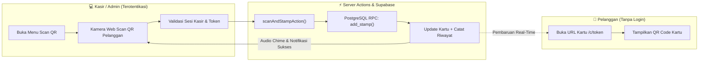

# 💳 LoyaltyCard

> **Platform Kartu Loyalitas Digital Multi-Tenant Modern untuk UMKM**  
> Solusi stempel digital berbasis web untuk kafe, barbershop, salon, laundry, dan retail. Gantikan kartu stempel kertas yang mudah hilang tanpa mewajibkan pelanggan menginstal aplikasi atau mendaftar akun.

---

## 🌟 Sorotan Fitur Utama

- ⚡ **Scan QR Kasir Otomatis (Auto-Stamp)**  
  Kasir dapat langsung memindai QR code dari ponsel pelanggan menggunakan kamera web aplikasi kasir. Begitu terdeteksi, sistem **langsung otomatis menambah stempel (+1)** dengan verifikasi sesi kasir, umpan balik suara (*audio chime*), dan indikasi haptic.
- 📱 **Akses Instan Tanpa Aplikasi & Tanpa Login**  
  Pelanggan cukup membuka tautan kartu unik dengan token acak berkekuatan kriptografi 192-bit (`/c/[token]`). Tampilan *mobile-first*, ringan, dan dapat disimpan di *bookmark* atau *homescreen* ponsel.
- 🔒 **Isolasi Multi-Tenant Mutlak (PostgreSQL RLS)**  
  Data setiap pemilik usaha terisolasi secara ketat pada level kernel basis data menggunakan PostgreSQL Row Level Security (RLS). Tidak ada kemungkinan kebocoran data silang usaha.
- 👥 **Role-Based Access Control (RBAC)**  
  Pemisahan hak akses yang tegas antara **Owner (Pemilik)** dan **Staff (Kasir)**. Staf kasir hanya memiliki izin operasional stempel dan penukaran reward tanpa hak mengubah konfigurasi toko atau data sensitif.
- 🛡️ **Pemberian & Pembatalan Stempel Atomik**  
  Seluruh mutasi status kartu, penambahan stempel, pembatalan (*void*), dan penukaran reward dieksekusi melalui PostgreSQL Stored Procedures (RPC) yang aman dari *race condition* dan manipulasi sisi klien.
- 🎨 **Kustomisasi Identitas Brand Lengkap**  
  Dukungan pengunggahan logo dengan pemotong latar belakang otomatis (*auto-cutout*), pemilihan warna tema (*brand color*), pemilihan ikon stempel, dan penyesuaian target jumlah stempel serta reward.
- 🔍 **Navigasi Cepat & Direct Access**  
  Pada daftar pelanggan di panel admin, mengeklik nama pelanggan langsung membuka kartu loyalitas pelanggan tersebut secara instan.
- 📜 **Legalitas & Kepatuhan Profesional**  
  Dilengkapi halaman resmi [Syarat Layanan](/terms) dan [Kebijakan Privasi](/privacy) yang transparan dan selaras dengan prinsip UU Perlindungan Data Pribadi (UU PDP No. 27/2022).

---

## 🏗️ Arsitektur Sistem



---

## 👥 Matriks Hak Akses Pengguna

| Fitur / Tindakan | Pemilik Usaha (Owner) | Staf / Kasir | Pelanggan Publik |
| :--- | :---: | :---: | :---: |
| Akses Dashboard Ringkasan Usaha | ✅ | ✅ | ❌ |
| Scan QR Pelanggan & Auto-Stamp | ✅ | ✅ | ❌ |
| Tambah Stempel Manual & Void Stempel | ✅ | ✅ | ❌ |
| Penukaran Hadiah (*Redeem Reward*) | ✅ | ✅ | ❌ |
| Pembuatan Kartu & Pendaftaran Pelanggan | ✅ | ✅ | ❌ |
| Pengaturan Usaha (Logo, Warna, Hadiah) | ✅ | ❌ | ❌ |
| Manajemen Staf (Undang / Hapus Kasir) | ✅ | ❌ | ❌ |
| Melihat Tampilan Kartu Loyalitas Pribadi | ✅ | ✅ | ✅ (Via Token) |
| Melihat Kartu Milik Tenant Lain | ❌ (Terblokir RLS) | ❌ (Terblokir RLS) | ❌ (Terblokir RLS) |

---

## 🛠️ Tech Stack

| Layer | Teknologi | Deskripsi |
| :--- | :--- | :--- |
| **Framework** | [Next.js](https://nextjs.org) (App Router) | React Server Components, Server Actions, Turbopack |
| **Bahasa** | [TypeScript](https://www.typescriptlang.org) | Strict Mode & Static Type Checking penuh |
| **Antarmuka & Gaya** | [Tailwind CSS](https://tailwindcss.com) + [shadcn/ui](https://ui.shadcn.com) | Desain modern, responsif, dark mode, dan aksesibilitas |
| **Database & Auth** | [Supabase](https://supabase.com) (PostgreSQL) | Auth, Storage, Row Level Security (RLS), Stored Procedures |
| **Kamera & QR** | `html5-qrcode` & `qrcode` | Pemindaian kamera real-time dan rendering SVG/Canvas QR |
| **Validasi Formulir** | [Zod](https://zod.dev) + React Hook Form | Validasi input skema ketat di sisi klien dan server |
| **Ikonografi** | [Lucide React](https://lucide.dev) | Ikon antarmuka modern yang bersih dan konsisten |
| **In-Memory DB Testing** | `@electric-sql/pglite` | Eksekusi tes SQL lokal berbasis WebAssembly PostgreSQL |

---

## 📁 Struktur Direktori

```text
loyaltycard/
├── public/                 # Aset statis & logo
├── scripts/
│   └── test-db.mjs         # Runner tes database in-memory PGlite
├── src/
│   ├── actions/            # Next.js Server Actions (Auth, Stamps, Tenant, Staff)
│   │   ├── auth.ts
│   │   ├── stamps.ts       # Logika stempel, void, redeem, & scanAndStampAction
│   │   ├── tenant.ts
│   │   └── staff.ts
│   ├── app/                # Next.js App Router
│   │   ├── (auth)/         # Halaman autentikasi (/login, /register, dll)
│   │   ├── admin/          # Panel Admin & Kasir (Terproteksi)
│   │   │   ├── cards/      # Manajemen & daftar kartu
│   │   │   ├── customers/  # Daftar pelanggan (klik nama langsung buka kartu)
│   │   │   ├── history/    # Log riwayat stempel & penukaran reward
│   │   │   ├── scan/       # Pemindai QR kamera kasir otomatis
│   │   │   ├── settings/   # Pengaturan identitas brand (Owner)
│   │   │   ├── staff/      # Manajemen staf kasir (Owner)
│   │   │   ├── layout.tsx  # Verifikasi sesi & proteksi tenant
│   │   │   └── page.tsx    # Ringkasan analitik usaha
│   │   ├── c/[token]/      # Tampilan publik kartu loyalitas pelanggan
│   │   ├── privacy/        # Halaman Kebijakan Privasi resmi
│   │   ├── terms/          # Halaman Syarat Layanan resmi
│   │   ├── layout.tsx
│   │   └── page.tsx        # Halaman pendaratan (Landing Page)
│   ├── components/         # Komponen UI modular
│   │   ├── ui/             # Tombol, input, kartu, dialog (shadcn/ui)
│   │   ├── loyalty-card.tsx# Kartu loyalitas interaktif
│   │   └── stamp-grid.tsx  # Grid slot stempel
│   ├── lib/                # Klien Supabase & utilitas pembantu
│   └── types/              # Deklarasi tipe TypeScript & skema basis data
└── supabase/
    ├── migrations/         # Migrasi SQL resmi (DDL, RLS, & RPC)
    └── tests/              # Suite pengujian keamanan & konkurensi SQL
```

---

## 🚀 Panduan Memulai Cepat (Local Setup)

### 1. Prasyarat Sistem
- **Node.js**: Versi 20 atau lebih baru
- **Package Manager**: `pnpm` (disarankan) atau `npm`
- **Supabase**: Proyek aktif di [Supabase](https://supabase.com)

### 2. Kloning Repositori & Instal Dependensi
```bash
git clone https://github.com/username/loyaltycard.git
cd loyaltycard
pnpm install
```

### 3. Konfigurasi Environment Variables
Salin template file `.env.example` ke `.env.local`:
```bash
cp .env.example .env.local
```

Isi variabel environment berikut dengan kredensial proyek Supabase Anda:
```env
NEXT_PUBLIC_SUPABASE_URL=https://your-project.supabase.co
NEXT_PUBLIC_SUPABASE_ANON_KEY=your-anon-key
SUPABASE_SERVICE_ROLE_KEY=your-service-role-key  # HANYA DIGUNAKAN DI SERVER
NEXT_PUBLIC_APP_URL=http://localhost:3000
```

> ⚠️ **Catatan Keamanan:** `SUPABASE_SERVICE_ROLE_KEY` hanya digunakan oleh Server Actions di sisi server (misal untuk mengundang staf). Jangan pernah mengekspos kunci ini ke repositori publik atau file klien (*client bundle*).

### 4. Eksekusi Migrasi Basis Data
1. Buka dashboard Supabase proyek Anda, lalu navigasikan ke **SQL Editor**.
2. Salin isi file `supabase/migrations/0001_init.sql` (dan migrasi berikutnya jika ada).
3. Jalankan skrip tersebut (*Run*). Skrip ini otomatis mengatur tabel, indeks, RLS policies, storage bucket, dan stored procedures atomik.

### 5. Menjalankan Tes Database & Keamanan Otomatis
Proyek ini dilengkapi pengujian SQL otomatis menggunakan **PGlite WASM** (PostgreSQL in-memory lokal) tanpa membutuhkan koneksi internet:
```bash
pnpm test:db
```
Pengujian ini memverifikasi secara ketat:
- **01_rls_isolation.sql**: Keamanan isolasi data lintas tenant dan penolakan akses tanpa izin.
- **02_concurrency_add_stamp.sql**: Integritas stempel, pencegahan kelebihan kuota kartu (*card_full*), dan penolakan *race condition*.
- **03_staff_permissions.sql**: Pembatasan hak akses kasir agar tidak dapat mengubah data pemilik atau menghapus kartu.

### 6. Menjalankan Server Pengembangan
```bash
pnpm dev
```
Buka browser dan akses [http://localhost:3000](http://localhost:3000).

---

## 🔒 Standar Keamanan & Perlindungan Data

- ✅ **Pemisahan Data Setingkat Kernel (PostgreSQL RLS)**  
  Seluruh kueri basis data difilter oleh Row Level Security. Kueri dari tenant A tidak akan pernah mengembalikan data tenant B.
- ✅ **Tidak Ada Mutasi Status Langsung dari Klien**  
  Tabel `cards`, `stamps`, dan `redemptions` tidak memiliki izin `UPDATE` atau `INSERT` langsung untuk publik; seluruh mutasi wajib melewati RPC *security definer*.
- ✅ **Token Akses Kriptografi Tinggi**  
  Tautan publik pelanggan menggunakan token acak 192-bit (`extensions.gen_random_bytes(24)`) yang aman dari serangan enumerasi.
- ✅ **Validasi Skema Berlapis (Zod)**  
  Setiap Server Action dan masukan pemindaian QR diverifikasi oleh skema Zod sebelum diproses.
- ✅ **Anti-Indeksasi Mesin Pencari**  
  Setiap halaman kartu publik pelanggan dilengkapi metadata `robots: { index: false, follow: false }` untuk menjaga privasi pelanggan dari mesin pencari publik.

---

## 📦 Panduan Deployment (Vercel)

1. Push repositori ke GitHub / GitLab.
2. Buka [Vercel Dashboard](https://vercel.com) dan buat proyek baru dengan mengimpor repositori ini.
3. Tambahkan 4 variabel environment pada menu **Settings -> Environment Variables**:
   - `NEXT_PUBLIC_SUPABASE_URL`
   - `NEXT_PUBLIC_SUPABASE_ANON_KEY`
   - `SUPABASE_SERVICE_ROLE_KEY`
   - `NEXT_PUBLIC_APP_URL` (arahkan ke URL domain produksi Anda)
4. Klik **Deploy**.
5. Pada dashboard Supabase, masuk ke **Authentication -> URL Configuration**, lalu daftarkan domain Vercel Anda pada **Site URL** dan **Redirect URLs**.

---

## 📄 Lisensi & Legalitas

- Hak Cipta &copy; 2026 **LoyaltyCard**. Seluruh hak cipta dilindungi undang-undang.
- Untuk syarat penggunaan layanan, silakan baca [Syarat dan Ketentuan](/terms).
- Untuk kebijakan privasi dan keamanan data pengguna, silakan baca [Kebijakan Privasi](/privacy).
